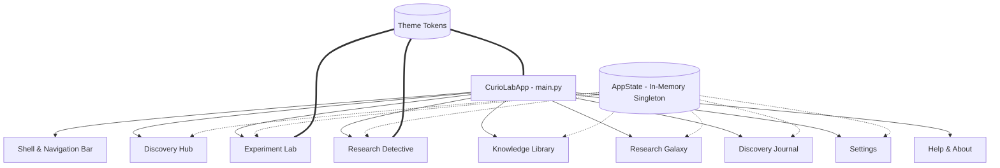

# CurioLab — An Interactive Research & Discovery Platform

[](https://www.python.org/)
[](https://docs.python.org/3/library/tkinter.html)
[](requirements.txt)
[](#installation--setup)
[](LICENSE)

> **CurioLab Desktop Core v1.0.0 (Research & Education Edition)**  
> A lightweight, offline-first desktop environment engineered for scientific exploration, mathematical experimentation, data forensic analysis, and systematic research documentation.

---

## Table of Contents

- [Overview & Vision](#overview--vision)
- [Key Features & Modules](#key-features--modules)
  - [1. Discovery Hub](#1-discovery-hub)
  - [2. Experiment Lab](#2-experiment-lab)
  - [3. Research Detective](#3-research-detective)
  - [4. Knowledge Library](#4-knowledge-library)
  - [5. Research Galaxy](#5-research-galaxy)
  - [6. Discovery Journal](#6-discovery-journal)
  - [7. Settings & Customization](#7-settings--customization)
  - [8. Help & About Center](#8-help--about-center)
- [Technology Stack](#technology-stack)
- [Project Architecture & File Structure](#project-architecture--file-structure)
- [Installation & Setup](#installation--setup)
- [How to Run](#how-to-run)
- [Keyboard Shortcuts](#keyboard-shortcuts)
- [Visual Interface & Screenshots](#visual-interface--screenshots)
- [Current Limitations](#current-limitations)
- [Future Roadmap](#future-roadmap)
- [Author & Contribution Information](#author--contribution-information)
- [Educational Integrity Disclaimer](#educational-integrity-disclaimer)

---

## Overview & Vision

Modern educational tools often suffer from browser bloat, mandatory cloud logins, external tracking, or fragile network dependencies. **CurioLab** was created to counter that trend.

CurioLab is a 100% offline desktop workspace built strictly with **Python** and **Tkinter**, requiring **zero third-party pip dependencies**. Inspired by the scientific curiosity and empirical rigor of pioneering polymaths—Richard Feynman, Claude Shannon, Ada Lovelace, Alan Turing, and Marie Curie—CurioLab provides students, researchers, and hobbyists with a self-contained laboratory for:

- Formulating testable scientific hypotheses.
- Designing custom mathematical models and evaluating them via a secure AST parser.
- Visualizing multi-run simulation curves and comparative metrics.
- Conducting forensic data investigations with statistical anomaly detection.
- Navigating interactive conceptual knowledge graphs.
- Maintaining an organized, searchable research journal.

---

## Key Features & Modules

### 1. Discovery Hub
The central command deck providing an immediate macro-level summary of your research progress:
- **Real-Time Telemetry Cards**: Dynamically updates monograph readings, journal note counts, active experiments, and forensic detective case milestones via the centralized `AppState` observer engine.
- **Global Federated Search**: Hit `Ctrl+F` (or `Cmd+F` on macOS) to instantly query articles, galaxy nodes, experiment configurations, and journal notes with automatic cross-module routing.
- **Quick-Launch Action Hub**: One-click shortcuts to spawn experiment builders, load investigative cases, or jot rapid journal entries.
- **Live Activity Feed**: Chronological ledger recording module transitions, analytical computations, and notebook edits.

### 2. Experiment Lab
A comprehensive scientific laboratory featuring both custom mathematical experiment building and interactive demonstration playgrounds:
- **Custom Experiment Builder**: A 4-step wizard guiding researchers through Metadata Definition, Mathematical Formulation, Parameter Bounds Configuration, and Input Space Setup.
- **Safe AST Evaluation Engine**: An Abstract Syntax Tree (AST) mathematical evaluator supporting arithmetic operators and mathematical functions (`sin`, `cos`, `tan`, `exp`, `log`, `sqrt`, `abs`, `pi`, `e`) with strict security validation—zero insecure `eval()` execution.
- **Dynamic 2D Plotting Canvas**: Native Tkinter graphics rendering line plots, scatter charts, and bar graphs with automatic axis scaling, tick placement, and dynamic gridlines.
- **Multi-Run History & Comparative Overlay**: Save multiple simulation runs, adjust variables, and superimpose runs on a unified comparative canvas with statistical delta summaries.
- **13-Field Research Documentation**: Dedicated structured dossier covering Independent/Dependent Variables, Controlled Conditions, Sample Size, Methodology, Observed Phenomena, and Hypothesis Status (`CONFIRMED`, `REFUTED`, `INCONCLUSIVE`, `REVISED`).
- **3 Preserved Built-in Laboratories**:
  - *Caesar Cipher Cryptographic Playground*: Real-time frequency analysis and key shift exploration.
  - *Single Artificial Neuron Simulator*: Interactive weights, bias, activation functions (Sigmoid, ReLU, Step), and 2D decision boundary visualization.
  - *Data Visualization Lab*: Built-in dataset exploration with dynamic scatter, line, and bar chart switching.

### 3. Research Detective
An empirical forensics workspace transforming passive quizzes into an authentic 7-stage investigative process:
- **Interactive 7-Stage Detective Map**: Visual progression pipeline connecting:
  1. *Research Question*
  2. *Evidence Collection*
  3. *Dataset Exploration*
  4. *Statistical Analysis*
  5. *Empirical Observations*
  6. *Hypothesis Formulation*
  7. *Scientific Conclusion*
- **Stage Inspector & Evidence Vault**: Real-time inspection panel providing stage briefs, operational instructions, and tagged evidence links.
- **Forensic Dataset Explorer**: Tabular data inspection with automated missing token detection (`NA`, `null`, `nan`, `?`), quartile baseline calculations, and IQR outlier identification.
- **Statistical Summary Suite**: Calculates sample size, mean, median, variance, standard deviation, min/max, and quartile boundaries.
- **Deduction Workspace**: Formal hypothesis testing board with direct export into the Discovery Journal.

### 4. Knowledge Library
An offline compendium of structured scientific monographs and research briefs:
- **Domain Taxonomy**: Browse articles categorized under Physics, Computer Science, Biology, Mathematics, Astronomy, and Chemistry.
- **Real-Time Text Filter**: Instant search filter highlighting keywords across article titles, abstracts, and key findings.
- **Interactive Citation Generator**: Generates standardized scientific citations with a single click and seamlessly transfers them to the Discovery Journal as notebook drafts.

### 5. Research Galaxy
An interactive 2D constellation map visualizing relationships between scientific disciplines, seminal ideas, and foundational theories:
- **Interactive Canvas Navigation**: Drag-to-pan, zoom controls, and click-to-focus node inspection.
- **Concept Dossier Panel**: Detailed breakdown of selected nodes including parent disciplines, foundational principles, cross-field applications, and historical milestones.
- **Cross-Module Linkage**: Transfer any concept dossier directly into the Discovery Journal for deeper study.

### 6. Discovery Journal
A built-in laboratory notebook designed for structured scientific record-keeping:
- **Full CRUD Capabilities**: Create, read, edit, duplicate, and delete research notes.
- **Tagging & Filtering System**: Categorize entries using customizable tags (`#physics`, `#cryptography`, `#hypothesis`) with real-time tag filtering.
- **Inbound Draft Integration**: Automatically receives dispatched notes from the Knowledge Library, Research Galaxy, and Experiment Lab.
- **Export Options**: Export entire notebooks or selected entries to formatted Markdown (`.md`) or Plain Text (`.txt`).

### 7. Settings & Customization
- **Theme Engine**: Switch between 4 tailored color palettes:
  - *Dark Horizon* (Modern high-contrast dark theme)
  - *Light Studio* (Clean, high-readability daytime theme)
  - *Cyberpunk Neon* (Vibrant futuristic palette)
  - *Scientific Slate* (Subdued, low-eye-strain laboratory theme)
- **Interface Scaling**: Adjustable base font sizing and UI density.
- **Data State Management**: Reset session state, restore educational sample datasets, or clear in-memory caches safely.

### 8. Help & About Center
- **Offline Operations Manual**: Step-by-step walkthroughs for every laboratory module.
- **Hotkeys Dossier**: Complete reference table of keyboard shortcuts.
- **Architecture Specifications**: Technical review of the AppState Observer pattern and Tkinter canvas rendering system.

---

## Technology Stack

CurioLab is intentionally built with **pure standard-library Python**, prioritizing zero dependency friction, maximum longevity, and instant portability across operating systems.

| Component | Technology | Description |
| :--- | :--- | :--- |
| **Language** | Python 3.10+ | Clean, readable, object-oriented implementation |
| **GUI Framework** | Tkinter / `tkinter.ttk` | Native desktop windowing and widgets |
| **Graphics Engine** | `tk.Canvas` | High-DPI mathematical plotting and vector graphs |
| **Formula Engine** | `ast` (Standard Library) | Secure Abstract Syntax Tree arithmetic parser |
| **Math & Statistics** | `math`, `statistics` | Standard mathematical and statistical calculations |
| **Data Processing** | `csv`, `json`, `io` | Structured dataset parsing and serialization |
| **Architecture** | Observer Pattern | Centralized `AppState` decoupled event distribution |

---

## Project Architecture & File Structure

```text
curiolab-interactive-research-platform/
├── .gitignore                      # Git exclusion rules (caches, venvs, backups, OS files)
├── LICENSE                         # Open-source MIT license
├── README.md                       # Comprehensive platform documentation
├── requirements.txt                # Dependency specification (Zero external pip packages)
│
├── main.py                         # Application entry point, window shell, Discovery Hub
├── app_state.py                    # Centralized AppState & Observer event distribution
├── theme.py                        # Design system tokens, color palettes, and fonts
├── sample_data.py                  # Preloaded educational datasets, monographs, and nodes
│
├── experiment_lab.py               # Experiment Lab: Builder Wizard, AST engine, 2D plotting
├── research_detective.py           # Research Detective: 7-stage map, inspector, data forensics
├── knowledge_library.py            # Knowledge Library: Offline catalog & citation manager
├── research_galaxy.py              # Research Galaxy: Interactive 2D concept constellation
├── discovery_journal.py            # Discovery Journal: Notebook CRUD, tagging & exports
├── settings.py                     # Laboratory settings, theme manager, and state controls
├── help_about.py                   # Help documentation, shortcuts table, and about dossier
│
├── test_stage6_detective.py        # Automated test suite for Research Detective (30 tests)
├── test_stage7_experiment_lab.py   # Automated test suite for Experiment Lab (31 tests)
└── verify_experiment_lab_visual.py # Visual verification & canvas export utility
```

### Architecture Overview



---

## Installation & Setup

### Prerequisites

Ensure **Python 3.10** or newer is installed on your system:

```bash
python3 --version
```

### 1. Clone the Repository

```bash
git clone https://github.com/iyogyasharma-09/curiolab-interactive-research-platform.git
cd curiolab-interactive-research-platform
```

### 2. Verify Tkinter Availability

Since CurioLab uses Tkinter, it is already bundled with Python on most systems:

- **macOS**: Included with official installers from [python.org](https://www.python.org/) or Homebrew (`brew install python-tk`).
- **Windows**: Included by default in standard Python installers.
- **Linux (Ubuntu/Debian)**: If not preinstalled, run:
  ```bash
  sudo apt-get update && sudo apt-get install python3-tk
  ```
- **Linux (Fedora/RHEL)**:
  ```bash
  sudo dnf install python3-tkinter
  ```
- **Linux (Arch Linux)**:
  ```bash
  sudo pacman -S tk
  ```

### 3. Dependencies

CurioLab requires **zero external pip packages**. You do not need to run `pip install` for third-party libraries.

---

## How to Run

Launch the platform with a single command from the project root:

```bash
python3 main.py
```

### Running Automated Test Suites

CurioLab includes comprehensive regression and unit test suites:

```bash
# Run Research Detective unit test suite (30 tests)
python3 -m unittest test_stage6_detective.py

# Run Experiment Lab unit test suite (31 tests)
python3 -m unittest test_stage7_experiment_lab.py

# Run all test suites combined (61 tests)
python3 -m unittest discover -s . -p "test_*.py"
```

---

## Keyboard Shortcuts

CurioLab provides native keyboard accelerators for rapid navigation:

| Shortcut (macOS) | Shortcut (Windows/Linux) | Action | Target Description |
| :--- | :--- | :--- | :--- |
| <kbd>⌘ Cmd</kbd> + <kbd>1</kbd> | <kbd>Ctrl</kbd> + <kbd>1</kbd> | **Discovery Hub** | Return to the primary overview dashboard |
| <kbd>⌘ Cmd</kbd> + <kbd>2</kbd> | <kbd>Ctrl</kbd> + <kbd>2</kbd> | **Experiment Lab** | Open simulation builder and mathematical lab |
| <kbd>⌘ Cmd</kbd> + <kbd>3</kbd> | <kbd>Ctrl</kbd> + <kbd>3</kbd> | **Research Detective** | Access 7-stage investigative forensics map |
| <kbd>⌘ Cmd</kbd> + <kbd>4</kbd> | <kbd>Ctrl</kbd> + <kbd>4</kbd> | **Knowledge Library** | Browse scientific monographs and citations |
| <kbd>⌘ Cmd</kbd> + <kbd>5</kbd> | <kbd>Ctrl</kbd> + <kbd>5</kbd> | **Research Galaxy** | Explore interactive 2D concept constellation |
| <kbd>⌘ Cmd</kbd> + <kbd>6</kbd> | <kbd>Ctrl</kbd> + <kbd>6</kbd> | **Discovery Journal** | Open research notebook and notes manager |
| <kbd>⌘ Cmd</kbd> + <kbd>7</kbd> | <kbd>Ctrl</kbd> + <kbd>7</kbd> | **Settings** | Configure themes, fonts, and data options |
| <kbd>⌘ Cmd</kbd> + <kbd>8</kbd> | <kbd>Ctrl</kbd> + <kbd>8</kbd> | **Help & About** | View platform guides and documentation |
| <kbd>⌘ Cmd</kbd> + <kbd>F</kbd> | <kbd>Ctrl</kbd> + <kbd>F</kbd> | **Global Search** | Focus the global federated search field |
| <kbd>Enter</kbd> | <kbd>Enter</kbd> | **Execute Search** | Run federated query across all modules |
| <kbd>Esc</kbd> | <kbd>Esc</kbd> | **Dismiss Search** | Close search overlay and return focus |

---

## Visual Interface & Screenshots

CurioLab features a clean, high-DPI desktop aesthetic utilizing tailored dark and light color tokens with subtle accents.

### Interface Highlights

```text
+-----------------------------------------------------------------------------------------+
| [Logo] CurioLab  |  [Q Search concepts, experiments, notes... (Ctrl+F)]  |  [Theme] [v]  |
+-----------------------------------------------------------------------------------------+
|  Discovery Hub  |  Experiment Lab  |  Research Detective  |  Knowledge  |  Galaxy  | ...|
+-----------------------------------------------------------------------------------------+
|                                                                                         |
|  [ Discovery Hub Overview ]                                                             |
|  +--------------------+  +--------------------+  +--------------------+                 |
|  | Monographs: 12     |  | Journal Notes: 8   |  | Experiments: 4     |                 |
|  +--------------------+  +--------------------+  +--------------------+                 |
|                                                                                         |
|  [ Recent Research Activity ]                                                           |
|  * [14:22] Executed multi-run simulation: Damped Harmonic Oscillator                    |
|  * [13:45] Dispatched citation to Journal: "Shannon Information Entropy (1948)"        |
|  * [11:10] Detective Case: Completed Stage 4 (Statistical Anomaly Detection)            |
|                                                                                         |
+-----------------------------------------------------------------------------------------+
| Ready  |  AppState: In-Memory  |  Platform Core v1.0.0 (Research & Education Edition)   |
+-----------------------------------------------------------------------------------------+
```

### Visual Preview & Placeholders

<!-- Screenshot Placeholders -->
| Module | Interface Description | Status |
| :--- | :--- | :--- |
| **Discovery Hub** | Main dashboard with telemetry statistics, search, and activity feed. | *Interface Screenshot Placeholder* |
| **Experiment Lab** | 4-step wizard, custom AST equation evaluation, and multi-run 2D canvas overlay. | *Interface Screenshot Placeholder* |
| **Research Detective** | 7-stage investigative map, stage inspector, tabular data explorer, and statistics. | *Interface Screenshot Placeholder* |
| **Research Galaxy** | 2D interactive node constellation graph with dynamic concept inspector. | *Interface Screenshot Placeholder* |
| **Knowledge Library** | Monograph split-view reader with category filters and citation generator. | *Interface Screenshot Placeholder* |
| **Discovery Journal** | Note editor, tag filtering sidebar, and Markdown export preview. | *Interface Screenshot Placeholder* |

> *Note: If you run CurioLab locally, you can export vector canvas snapshots directly using `verify_experiment_lab_visual.py`.*

---

## Current Limitations

CurioLab is intentionally structured as a self-contained educational simulation platform. The current release has the following documented limitations:

1. **In-Memory State Storage**: All application runtime state (notes created during the session, custom experiments defined, detective stage progression) is maintained within `AppState` in memory.
2. **Session Reset on Exit**: When the application window is closed, any newly added in-memory journal notes or experiment configurations reset back to the preloaded sample baseline. (Users can use the **Export to Markdown/Text** feature in Discovery Journal to persist their work externally).
3. **Educational Demonstration Content**: All preloaded monographs, historical citations, and datasets are curated solely for educational modeling and discovery exercises. They do not represent real-world peer-reviewed publications, live DOIs, or external database records.

---

## Future Roadmap

Planned enhancements for future iterations of CurioLab include:

- [ ] **Optional Local SQLite Storage**: User-configurable toggle to persist journal notes, custom experiments, and detective progress to a local `.db` file without external servers.
- [ ] **CSV / JSON File Import**: File dialog enabling users to import external CSV datasets directly into the Experiment Lab and Research Detective.
- [ ] **Export to PDF**: Generate compiled, formatted scientific laboratory reports combining mathematical plots, journal notes, and detective findings.
- [ ] **Additional Built-in Simulations**:
  - Double pendulum chaotic dynamics playground.
  - Genetic algorithm optimization visualizer.
  - Cellular automata (Conway's Game of Life) experimentation chamber.
- [ ] **Equation LaTeX Rendering**: Mathematical formula preview using native vector glyphs.

---

## Author & Contribution Information

- **Developer & Creator**: Yogya Sharma ([@iyogyasharma-09](https://github.com/iyogyasharma-09))
- **Project Repository**: [curiolab-interactive-research-platform](https://github.com/iyogyasharma-09/curiolab-interactive-research-platform)
- **License**: MIT License

### Contributing

Contributions, feature suggestions, and issues are welcome!
1. Fork the repository.
2. Create your feature branch (`git checkout -b feature/NewSimulation`).
3. Ensure all tests pass (`python3 -m unittest discover -s . -p "test_*.py"`).
4. Commit your changes (`git commit -m 'feat: Add new simulation module'`).
5. Push to the branch (`git push origin feature/NewSimulation`).
6. Open a Pull Request.

---

## Educational Integrity Disclaimer

CurioLab is an interactive learning platform designed for local educational simulation and discovery. All scientific monographs, author labels, citation records, and relationship graphs contained herein are strictly educational demonstration models. They do not represent or fabricate real-world peer-reviewed publications, living authors, DOI identifiers, or academic metrics.
